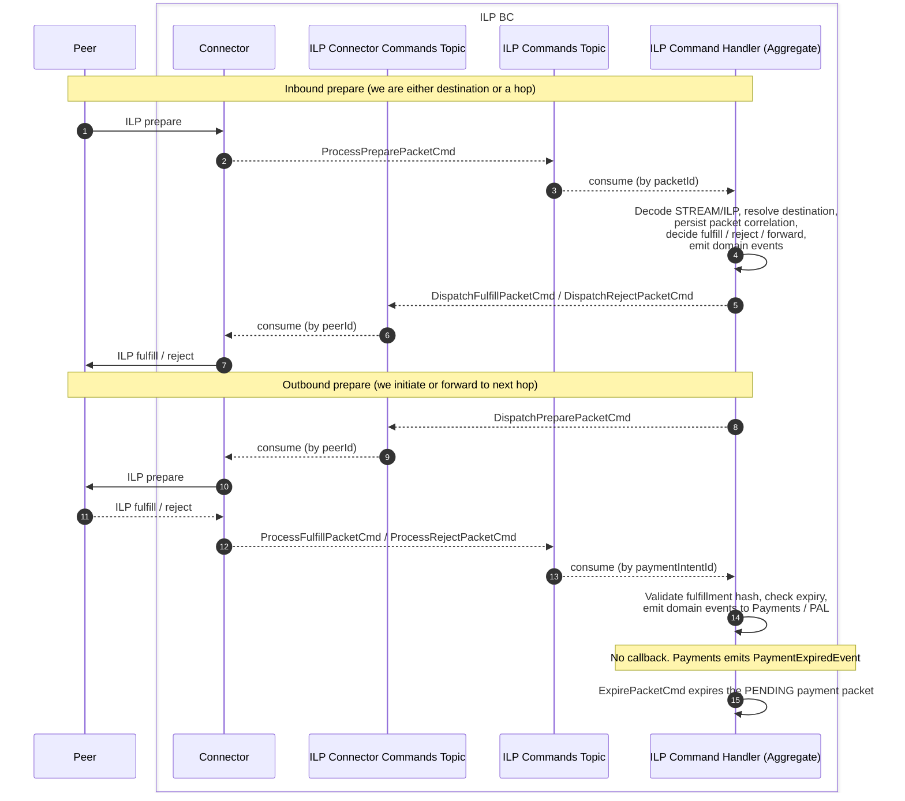

# ILP BC - Connector Integration

## Overview

The ILP connector is an integration adapter that lives **inside the ILP BC**. It owns the transport layer (ILP wire encoding/decoding, TCP/HTTP connection management, per-peer connection pools, wire-level retries and timeouts) and translates external traffic into internal Kafka commands.

The ILP aggregate (the command handler) owns all domain logic: fulfill/reject/forward decisions, persistence of packet correlations, business expiry, domain event emission, and integration with Payments and PAL.

The connector and the ILP aggregate communicate **exclusively via Kafka commands** (symmetric Kafka transport, no gRPC API in the middle). This lets the connector be replaceable per transport (HTTP, etc.) without touching the rest of Rhyza, and lets the connector and aggregate scale and fail independently.

## Sequence diagram

Cross-BC integration (PAL liquidity, Payments BC events, Notifications, etc.) flows are captured in the per-flow diagrams in this folder. This diagram focuses only on the ILP BC - Connector boundary.

## Topics

Two dedicated topics carry the connector - ILP aggregate traffic. Domain events for other BCs continue to flow on `ilp-domain-events` as before.

| Topic                    | Direction              | Purpose                                                                              |
| ------------------------ | ---------------------- | ------------------------------------------------------------------------------------ |
| `ilp-commands`           | Connector -> Aggregate | Commands the aggregate must process (incoming prepare, terminal results of outbound) |
| `ilp-connector-commands` | Aggregate -> Connector | Commands the connector must execute on the wire (dispatch prepare, send response)    |
| `ilp-domain-events`      | Aggregate -> other BCs | Public domain events (unchanged, e.g. `ILPPaymentConfirmedEvent`)                    |

## Commands

Command verbs match existing ILP BC conventions: `Process*` for commands handled by the aggregate, `Dispatch*` for commands handled by the connector (mirroring the existing `IPeeringClient.dispatch` interface). The set is symmetric across the two directions.

| Command                    | Topic                    | Producer  | Consumer  | Purpose                                                       |
| -------------------------- | ------------------------ | --------- | --------- | ------------------------------------------------------------- |
| `ProcessPreparePacketCmd`  | `ilp-commands`           | Connector | Aggregate | An ILP prepare arrived from a peer                            |
| `ProcessFulfillPacketCmd`  | `ilp-commands`           | Connector | Aggregate | Fulfill received for a previously dispatched outbound prepare |
| `ProcessRejectPacketCmd`   | `ilp-commands`           | Connector | Aggregate | Reject received for a previously dispatched outbound prepare  |
| `DispatchPreparePacketCmd` | `ilp-connector-commands` | Aggregate | Connector | Send an ILP prepare to a peer                                 |
| `DispatchFulfillPacketCmd` | `ilp-connector-commands` | Aggregate | Connector | Send a fulfill back to the source peer of an inbound prepare  |
| `DispatchRejectPacketCmd`  | `ilp-connector-commands` | Aggregate | Connector | Send a reject back to the source peer of an inbound prepare   |
| `ExpirePacketCmd`          | `ilp-commands`           | ILP event handler | Aggregate | Expire the PENDING payment packet after `PaymentExpiredEvent` |

## Partitioning

Kafka guarantees ordering only within a partition, so message keys are chosen to match the unit of work the consumer cares about.

- **`ilp-connector-commands` - partition by `peerId`.** The connector's per-peer state (connection pool, credentials, in-flight tracking) lives behind a single partition consumer per peer. Per-peer order on the wire is preserved.
- **`ilp-commands` (outbound result path: `ProcessFulfillPacketCmd` / `ProcessRejectPacketCmd`, and `ExpirePacketCmd` from payment expiry) -> partition by `paymentIntentId`.** Avoids the hot-partition problem with few peers and scales with payment workload. The connector does not need to decode/decrypt the response packet to obtain `paymentIntentId`: it was included in the original `DispatchPreparePacketCmd` and is held in the connector's in-flight correlation map keyed by `packetId` until the terminal response arrives. `ExpirePacketCmd` uses the same key so it is ordered with that callback.
- **`ilp-commands` (inbound: `ProcessPreparePacketCmd`) -> partition by `packetId`.** The connector does not have a `paymentIntentId` at this point (decoding STREAM/ILP is a domain concern), `peerId` shouldn't be used for hot-partition reasons, and inbound packet ordering does not matter. Correlation state for forwarding / response is resolved from the repository on the aggregate side.

## Peer deactivation

When a peer is administratively deactivated, in-flight packets are handled by the ILP aggregate (which already holds the in-flight state) rather than the connector:

1. The aggregate finishes the flow for packets that were already initiated before deactivation, dispatching `DispatchFulfillPacketCmd` / `DispatchRejectPacketCmd` as normal for those specific in-flight requests.
2. The aggregate communicates the deactivation to the connector along with the allow-list of in-flight `packetId`s that should still be honored on the wire as continuation requests.
3. Any new incoming prepare from the deactivated peer is rejected immediately by the connector with a generic error - deactivation is treated distinctly from insufficient liquidity, and details are not leaked to the peer.
4. Late fulfill responses for in-flight outbound prepares are still accepted by the aggregate (the transaction has already executed on the other side) so liquidity is updated correctly. This means the aggregate continues to consume `ProcessFulfillPacketCmd` / `ProcessRejectPacketCmd` for those specific packets even after deactivation.

## Notes and topics TBD

- Connector is almost stateless. It only holds what is needed to correlate fulfill/reject back to the originating prepare, with a TTL at the packet's `expiresAt`, and is easy to replicate.
- Packet correlation persistence, routing/next-hop lookup (from PAL data), and applying `ExpirePacketCmd` all live in the aggregate. Payments owns the expiry timer and emits `PaymentExpiredEvent`. The connector does not synthesize a reject when a callback never arrives.
- A fulfill or reject for a packet that is already `EXPIRED` is a no-op in the aggregate.
- Cross-BC integration (Payments, PAL, etc.) continues to go through `ilp-domain-events`.
- **TBD:** Auth tokens / peer credential handling
