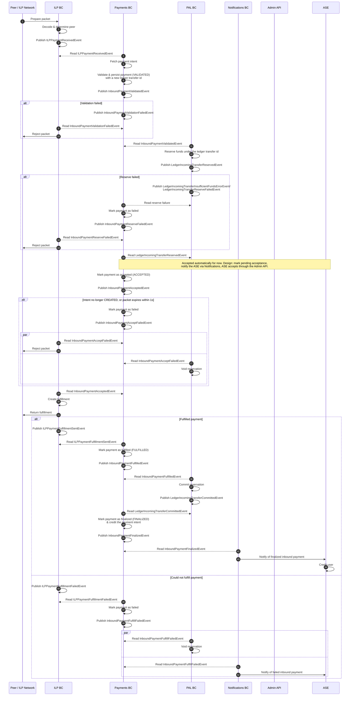
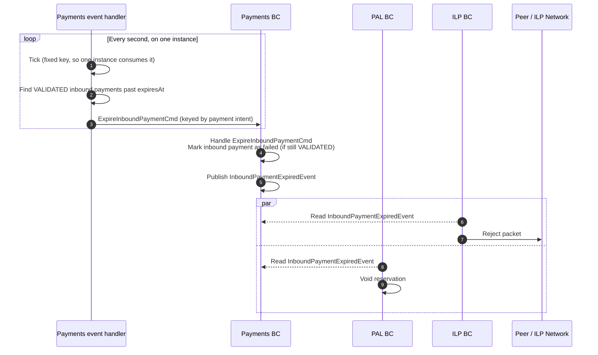

# Remote Outgoing Payment - Receiving

Funds are reserved, then the fulfill is sent, then the reservation is committed. The inbound payment moves `VALIDATED` → `ACCEPTED` → `FULFILLED` → `FINALIZED`, or to `FAILED` from any step before the fulfill.

- Payments creates the ledger transfer id at validation, so a payment that fails while its reservation is in flight can still be voided. PAL ignores a reserve for a transfer id it already holds.
- PAL commands are keyed by asset code and payment events by payment intent, so PAL always handles the reserve before a void for the same payment. A reserve that lands after the payment failed is voided; the late accept is ignored.
- Commands for a step that already happened do nothing.
- If the commit fails after the fulfill went out, Payments logs an error for reconciliation and the payment stays `FULFILLED`. Nothing reconciles it automatically yet.
- Notifications reacting to inbound payment events is not implemented yet.

## Expiry

The inbound payment stores the packet's `expiresAt`. Validate and Accept refuse a payment whose packet expires within 1s, the time the fulfill needs to reach the sender. The check below expires payments still `VALIDATED` after their `expiresAt`, for example when PAL never answered.

- `ACCEPTED` payments are not expired: ILP may be sending the fulfill at that moment, and voiding it would lose funds. ILP refusing to fulfill a packet past its expiry, and reporting a failed fulfill, covers that case (#421).
