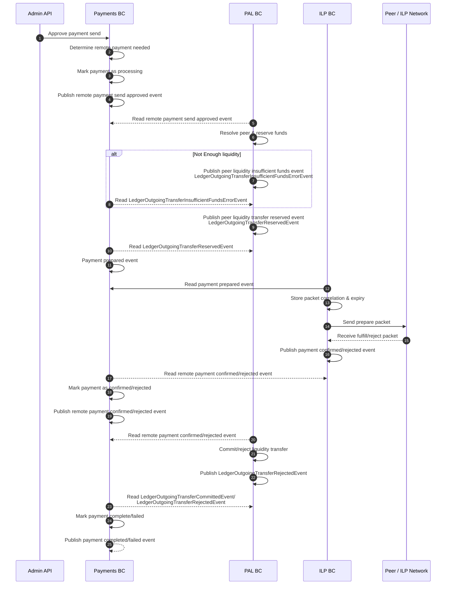
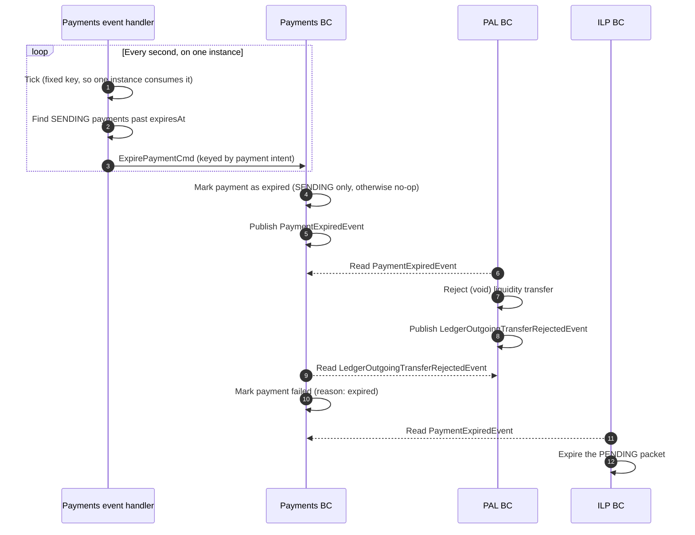

# Remote Payment - Sending

# Expiry

When the payment is prepared, Payments sets the packet deadline to `min(now + 30s, intent expiry)` and sends it on the payment prepared event. The payment itself expires a grace period (5s) after the packet deadline, so a fulfill that reaches the connector in time also reaches Payments before the payment expires.

- `EXPIRED` waits for PAL the way `REJECTED` does, then becomes `FAILED`.
- A late ILP failure for an expired payment is ignored.
- A late fulfill for an expired payment is logged as an error that needs reconciliation. The grace period makes this rare but cannot rule it out, and nothing reconciles it automatically yet.
- PAL releasing the reservation (#365) and ILP expiring the packet (#366) are separate changes.
- The same check expires `CREATED` payment intents past their `expiresAt`.

# Notes

- Should we mark the outgoing remote payment as completed/failed _after_ the PAL BC finalizes or voids the liquidity transfer? Or should we be optimisic? What is a "pending" transfer in the first place?
