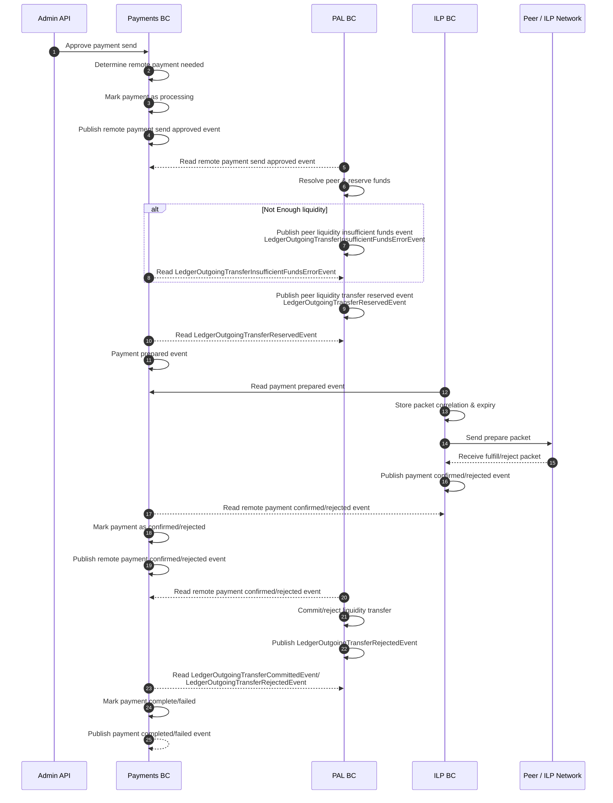

# Remote Payment - Sending

# Notes

- Should we mark the outgoing remote payment as completed/failed _after_ the PAL BC finalizes or voids the liquidity transfer? Or should we be optimisic? What is a "pending" transfer in the first place?
