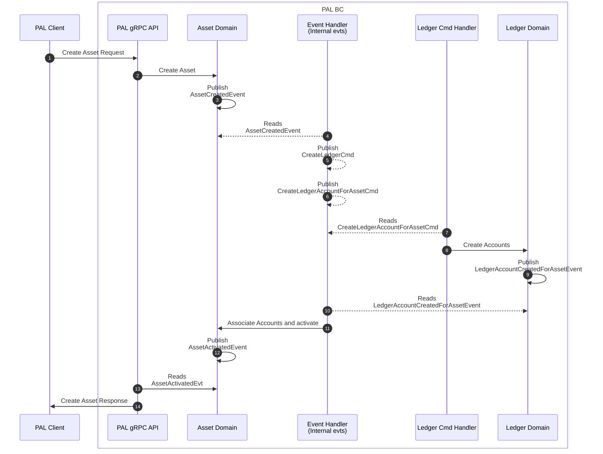
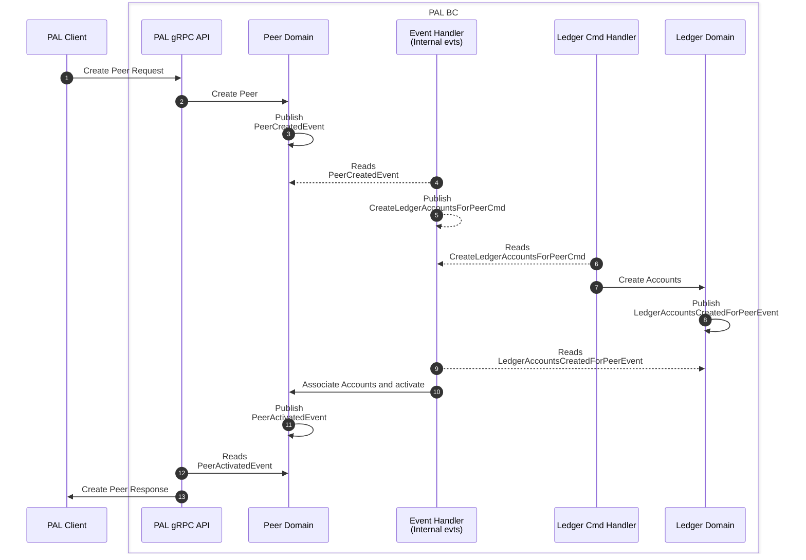

# PAL services

PAL has three main services:

- PAL API Service
- Ledger Command Handler Service
- Event Handler Service

## PAL API Service

This service is the endpoint for all request-response communication style functionality for the PAL, it serves over gRPC in a sync request-response style and has a TypeScript client implementation available.

Main features:

- All Peers functionality - Create, manage and query peers
- All Asset functionality - Create, manage and query peers
- Liquidity management functionality - Create and manage ledgers and ledger accounts
- Liquidity queries

Note: Ledger high performance requests, such as posting transactions, are handled by a saga pattern style of communications and are not available via the gRPC API. See command handler for details.

## Ledger Command Handler Service

This command handler service is responsible for handling ledger command messages, for as posting transactions and managing ledgers and ledger accounts. It uses a saga pattern style of communications to handle high performance requests.
Commands are passed to the domain code for processing, the result is the publishing of domain/integration events (success or falure).

## BC Integration Diagrams

### Saga Pattern for Asset Creation, including account creation in ledger

When an asset is created, a ledger for that asset is automatically created for that asset code; Additionally, a ledger account (system account) is created for the asset.
Only when both, the ledger and the ledger account, are created, the asset is marked as active.
At the end of the successful process, the asset will be active and have a property with the ledger account id (system account).

Per asset, one ledger account is created with the asset code as its external id:

- Asset System Account

### Saga Pattern for Peer Creation, including account creation in ledger

When an peer is created, the corresponding ledger accounts are created for that peer.
When the accounts are created, the peer is updated with the ledger account ids and is marked as active.

Per peer, five accounts are created, with the peer id as its external id:

- Peer Liquidity
- Peer Clearing
- ASE Liquidity
- ASE Clearing
- Suspense

