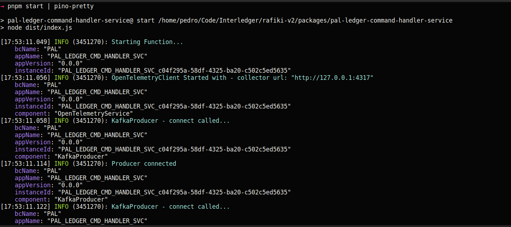
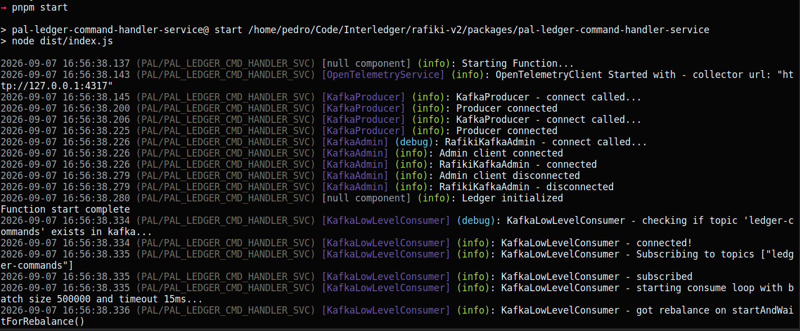

# Rafiki v2 Common Implementations Lib

This library provides common implementations for technical components required by throughout the project.

Basic rules:

- All implementations must implement a correspondent interface declared in the [common-types-lib](/packages/common-types-lib)
- Domain code cannot import/reference this library, only the interfaces in common-types-lib
- Application code layer components, like services, can import/reference this lib
- Internal clients libs or CLI tools for development can can import/reference this lib
- Any library to be made available outside Rafiki should not

If Bounded context's require specific implementations that no other BCs require, or if they require specializations of the implementations provided by this library, then that BC should create its own implementations lib, as done for example, in pal-implemenation-lib.

## Getting Started

For Prerequisites and install notes, see the main project README.me file [here](/README.md)

## Implementations Documentation

### Logger

This lib provides the PinoLogger class, which is the default ILogger implemenation for the project, it is based on [Pino](https://github.com/pinojs/pino).

#### Basic usage

To instantiate a logger instance, do (usually from a service):

```typescript
// eslint-disable-next-line @typescript-eslint/no-require-imports
const packageJson = require(join(process.cwd(), 'package.json'));
const BC_NAME = 'PAL';
const APP_NAME = `${BC_NAME}_LEDGER_CMD_HANDLER_SVC`;
const APP_VERSION = packageJson.version || '0.0.0';
const INSTANCE_ID = `${APP_NAME}_${crypto.randomUUID()}`;

const logger: ILogger = new PinoLogger({
  bcName: BC_NAME,
  appName: APP_NAME,
  appVersion: APP_VERSION,
  instanceId: INSTANCE_ID
});
```

Using it:

```typescript
logger.trace('trace message');
logger.debug('debug message');
logger.info('info message');
logger.warn('warn message');
logger.error('error message');
logger.fatal('fatal message');
```

To log errors with the corresponding stack traces, pass them as the first argument:

```typescript
const err = new Error('Cannot find something');
logger.error(err, 'something happened');
```

Same for other objects - pass them as the first argument:

```typescript
logger.debug(myObject, 'my object message');
```

#### Child components

To create a logger child component from a logger class, execute child() passing the name of the new component. All log entries of this child logger with include the component property, allowing for better log filtering.

```typescript
const cmdHandlerLogger = existingLogger.child('commandHandler');
```

#### Setting the logger level

A logger can have its log level changed by using the setLogLevel() function.

Levels can be: `"fatal" | "error" | "warn" | "info" | "debug" | "trace"`

```typescript
logger.setLogLevel('info');
```

#### Checking if a certain log level is enabled

The logger by default ignores requests to log below the enabled log level, however, there are times, when the desired log message includes non-trivial computations, typically when using [template literals](https://developer.mozilla.org/en-US/docs/Web/JavaScript/Reference/Template_literals). Using this method, we can avoid the processing of the parameter (which would be ignored by the logger).

```typescript
// avoid executing the second branch if debug is not enabled
logger.isDebugEnabled() &&
  logger.debug(`received request: ${JSON.stringify(req, null, 2)}`);

// more traditional/verbose way
if (logger.isDebugEnabled()) {
  logger.debug(`received request: ${JSON.stringify(req, null, 2)}`);
}
```

### Pretty Printing

Pino logger's output is a JSON object per each line, which can be ingested by log processing facilities.
If we want to see the logs in human-readable format on the standard output (console), we can simply run our code piping it to [pino-pretty](https://github.com/pinojs/pino-pretty) like so:

```bash
pnpm start | pino-pretty
```

This will result in this sort of output:


If we want to have a simple one-line format, we can also set the LOGGER_PRETTY environment variable, which will use the CustomLoggerPrettifier, and not require the pipe or the installation of pino-pretty

Run like this:

```bash
  pnpm start
```

Or by setting the env var on the session:

```bash
export LOGGER_PRETTY=1
# now you can run it without LOGGER_PRETTY=1 for the rest of the session
pnpm start
```

This will result in this sort of output:


#### Simple console logger

There is a plain ILogger compatible console logger in [common-types-lib](/packages/common-types-lib/src/logger.ts) called `ConsoleLogger`, which relies exclusively on Node.js functionality and can be used for tests, tools or other scenarios where a proper logger is not required.
